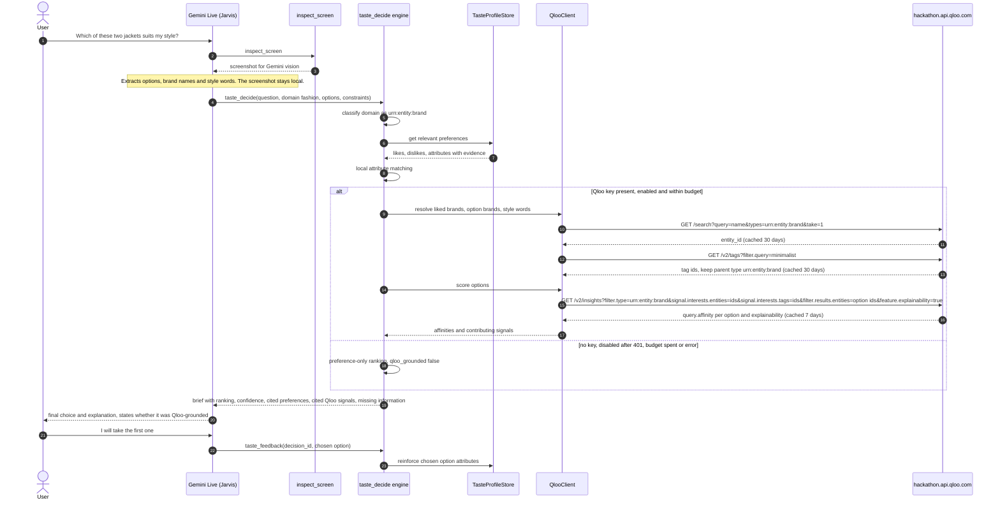

# Integration design: Qloo in QLOO Jarvis

**Status:** implemented in `src/Services/Taste/` (`TasteProfileStore`, `TasteDecisionEngine`,
`TasteJarvisTools`) and `src/Services/Qloo/` (`QlooClient`, `QlooCredentialStore`); settings routes in
`src/Services/WebSettingsService.Qloo.cs`. Test results: [EVALUATION.md](EVALUATION.md). Where code and
this document disagree, update one of them.

## Roles

- **Gemini Live (the existing Jarvis) stays the orchestrator.** It handles intent, vision (the existing `inspect_screen` tool), planning, the final choice and the explanation.
- **Qloo is a local Jarvis tool path.** Jarvis calls it in-process through `QlooClient`, not through the connector relay.
- **Toggle "Qloo cultural intelligence"** (default **on**). The taste tools are offered only when it is on. When it is off, `BuildTools` and the system prompt are **byte-for-byte the original Jarvis**.

## Tools (offered only when the toggle is on)

| Tool | Input | Effect |
| --- | --- | --- |
| `taste_decide` | `question`, `domain`, `options[]` (each `{label, description, attributes[], entity{name, type}, meets_constraints}`), `constraints`, `context`, `location` | Generic decision engine. Mode comes from the request: with options it runs **choose** (one pick) or **rank** (full order), and with no options it runs **recommend**. Returns a brief (below). |
| `taste_observe` | One preference observation: kind (`explicit`, `inferred`, `negative`, `contextual` or `temporary`), the preference, and its evidence | Records it in `TasteProfileStore`. Sensitive attributes are refused (see [Privacy](#privacy)). |
| `taste_feedback` | `decision_id` plus the chosen or rejected option | Reinforces that option's attributes in the profile. |
| `taste_profile` | Action `list`, `forget` or `correct` | Lets the user inspect and edit what Jarvis remembers. |

## Engine steps (`taste_decide`)

1. **Classify Qloo relevance by domain.**

   | Domain | `filter.type` |
   | --- | --- |
   | movies | `urn:entity:movie` |
   | tv | `urn:entity:tv_show` |
   | music | `urn:entity:artist` |
   | books | `urn:entity:book` |
   | podcasts | `urn:entity:podcast` |
   | games | `urn:entity:video_game` |
   | dining, hotels, venues | `urn:entity:place` |
   | travel | `urn:entity:destination` (needs `signal.interests.entities`, [Entity Type Guide][et]) |
   | fashion, brands, products | `urn:entity:brand` |
   | people | `urn:entity:person` |
   | technical, maths, logistics, other | **no Qloo call** |

2. **Retrieve relevant preferences** from `TasteProfileStore` for that domain: likes, dislikes, attributes, and contextual or temporary notes, each with its evidence.
3. **Local attribute matching.** Compare each option's `attributes[]` with the stored preferences. This works even without Qloo.
4. **Resolve inputs to Qloo IDs.**
   - Liked entities: `GET /search?query=<name>&types=<target type>&take=1`, cached ([Search][se]).
   - Style words: `GET /v2/tags?filter.query=<word>`. Keep only tags whose `parents[].type` matches the target `filter.type` **[LIVE 2026-10-31]** ([Tags][tg]).
   - Options: resolve each `entity{name, type}` through `/search` the same way.
5. **Score the user's options (choose and rank modes):**
   `GET /v2/insights?filter.type=<type>&signal.interests.entities=<liked ids>&signal.interests.tags=<tag ids>&filter.results.entities=<option ids>&feature.explainability=true`
   This returns only those options, each with `query.affinity` **[LIVE 2026-10-31]** ([Parameter Reference][pr], [Deep Dive][dd]).
6. **Recommend mode** uses the same signals plus `filter.exclude.entities=<disliked ids>`, and `filter.location.query=<locality>` for places. With one locality, check that `query.locality.signal` is present ([Deep Dive][dd]).
7. **Combine** hard constraints, preference evidence and Qloo affinity into a ranked brief:
   - Options with `meets_constraints=false` rank below every option that meets them.
   - Affinities are compared only within the same response. Small gaps count as ties, because scores are normalised per query and close values carry no real meaning ([Interpreting Affinity Scores][ias]).
   - Confidence is qualitative (`high`, `medium`, `low`). It is higher when preference evidence and Qloo agree and the gap is clear. It is lower when evidence is thin, the scores are close, or Qloo did not score an option.
   - An option that Qloo did not return gets "no Qloo score". It is not treated as zero.
8. **Gemini makes the final call** and must say whether the result was Qloo-grounded. Qloo output is presented separately from Gemini's interpretation, and never as a probability about the user ([kit: safe use][kit-safe]).

### Brief returned to Gemini

```text
decision_id, mode (choose|rank|recommend), domain, qloo_type | null
qloo_grounded: bool, setup_message (when relevant)
ranked[]: label, rank, meets_constraints, qloo_affinity (0..1 | null), confidence (high|medium|low),
          cited_preferences[], cited_qloo_signals[]
missing_information[]
```

## Quota, reliability and fallback

| Control | Value |
| --- | --- |
| Per-request cap | 8 Qloo calls per `taste_decide` |
| Daily budget | 150 calls by default, persisted across restarts |
| Cache | Private, on disk under `%LOCALAPPDATA%\QLOO`: `/search` and `/v2/tags` for 30 days, `/v2/insights` for 7 days. Allowed by Qloo: private caching has no time limit, and data must never go into a public repo ([hackathon guide][hg]). |
| De-duplication | Identical in-flight requests share one HTTP call |
| Timeout | 8 s |
| Retry | One retry with backoff, **only** for 429, 5xx or timeout. This is a bounded retry ([kit: API access][kit-access]). |
| 401 | Qloo calls are disabled until the key changes |
| Logging | The key is never logged |
| Fallback | Missing key, disabled after 401, error, or budget spent: a preference-only result flagged `qloo_grounded=false`, with a setup message where relevant |

## Key storage

- **Primary:** a DPAPI-protected file `qloo-api-v1.dat` in the QLOO profile. The key is entered through a native Windows dialog or imported from a local file.
- **Developer fallback:** the `QLOO_API_KEY` environment variable. The hackathon kit uses the same variable name ([kit: troubleshooting][kit-trouble]).
- **Base URL:** `https://hackathon.api.qloo.com`, with the `X-Api-Key` header ([hackathon guide][hg]).
- The key never appears in the repo, in prompts or in logs ([kit: API access][kit-access], [kit: safe use][kit-safe]).

## Privacy

- **Screenshots never go to Qloo.** Gemini extracts only short entity names (for example a brand or film title) and tag words, and only those are sent.
- The preference store **refuses sensitive attributes**: health, religion, politics, sexuality, ethnicity, finances, precise location, identifiers.
- No names, email addresses, device or account IDs, or location histories are sent to Qloo. Results are never used to infer sensitive traits ([kit: safe use][kit-safe]). `filter.location.query` carries a locality name, never a precise position.
- No audience or demographic parameters are used. See [API_MAP.md](API_MAP.md#not-used-by-jarvis).

## Sequence: screenshot-based comparison



## Open risks

- **Access surface.** The hackathon kit names the `@qloo/qloo-harness` commands as the event's supported surfaces ([kit: API access][kit-access]). The docs.qloo.com hackathon guide documents direct HTTP with `X-Api-Key` ([hackathon guide][hg]). Jarvis calls the API directly. Confirm with the organisers if submission rules require the harness.
- **`filter.location.query` for places.** The Parameter Reference and the recipe support it, but the Entity Type Guide omits it. Verify `query.locality.signal` on the first live place call.
- **`video_game` spelling.** The hackathon guide uses `video_game`, while the clone's Deep Dive uses `videogame`. A 403 or an empty result on games should be logged without the key.
- **Tag-signal explainability** has not been observed live yet. Only entity-signal explainability has.

[hg]: https://docs.qloo.com/reference/qloo-llm-hackathon-developer-guide
[dd]: https://docs.qloo.com/reference/insights-api-deep-dive
[pr]: https://docs.qloo.com/reference/parameters
[et]: https://docs.qloo.com/reference/available-parameters-by-entity-type
[se]: https://docs.qloo.com/reference/get-search
[tg]: https://docs.qloo.com/reference/get-tags
[ias]: https://docs.qloo.com/docs/interpreting-affinity-scores
[kit-access]: https://github.com/qloo/qloo-hackathon-kit/blob/main/docs/API_ACCESS.md
[kit-safe]: https://github.com/qloo/qloo-hackathon-kit/blob/main/docs/SAFE_USE.md
[kit-trouble]: https://github.com/qloo/qloo-hackathon-kit/blob/main/docs/TROUBLESHOOTING.md
